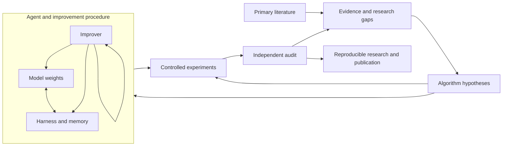

# RSI Research Hub

A research hub for **Recursive Self-Improvement, Agent Harness Evolution, Meta-Learning, and Model–Harness Co-Evolution**.

This repository connects primary-source literature review to research-gap analysis, algorithm design, reproducible evaluation, and eventual academic publication. Its purpose is to explain **what improves, why it improves, what the evidence supports, and which experiments could establish a new contribution**.

**Review cutoff:** November 19, 2026. **Current stage:** literature and protocol development. **Independent scientific reproductions:** none. The repository contains **35 full paper reviews**, four unvalidated algorithm proposals, and six benchmark guides. It is a curated research snapshot, not an exhaustive census or a claim that general RSI has been achieved.

## What is recursive self-improvement?

An agent may improve by changing model weights, prompts, tools, memory, skills, or control flow. Recursive self-improvement additionally involves retained changes participating in the production of further improvements. This mechanism should be distinguished from the stronger empirical claim that a later improver is actually better at improving a common starting agent.

Let $s_t=(\theta_t,h_t,m_t)$ be the model, harness, and memory, and $I_{\phi_t}$ an improvement procedure. A simplified loop is

$$
\widetilde s_{t+1}=I_{\phi_t}(s_t,E_t;B_t),\qquad
s_{t+1}=\operatorname{Gate}(s_t,\widetilde s_{t+1};V_t).
$$

Changing $\phi_t$ or reusing modified agent code can create recursion. Demonstrating a better improver requires a same-start, same-budget comparison and a separate audit. Merely increasing a benchmark score, writing more skills, or repeating a fixed training rule is insufficient. See [Foundations](docs/rsi-fundamentals.md).

## Why this research matters

Agent performance depends on the surrounding software as well as model parameters. Automating its improvement could reduce engineering effort, adapt smaller models to specialized workflows, and reuse knowledge across tasks. The same feedback loops can also amplify benchmark shortcuts, noisy selection, incompatible updates, and hidden evaluation costs. Useful research must separate these effects before asserting progress.



## Research taxonomy

| Area | Main object of change | Central question | Guide |
| --- | --- | --- | --- |
| Foundations | Definitions and evidence | What distinguishes self-improvement, recursion, and improved improvers? | [Read](docs/rsi-fundamentals.md) |
| Harness RSI | Prompts, skills, tools, memory, context, workflows | Does a persistent update benefit the executor and transfer? | [Read](docs/harness-rsi.md) |
| Model RSI | Weights, synthetic data, RL, post-training | Does training improve capability under a fixed or changing interface? | [Read](docs/model-rsi.md) |
| Meta-RSI | Improvement policies, meta-skills, search and evaluation | Can a better improver transfer from a clean starting state? | [Read](docs/meta-rsi.md) |
| Co-evolution | Model–harness pairs | Can coupled updates improve utility without unacceptable regression? | [Read](docs/model-harness-coevolution.md) |

## Featured reading

| Work | Reason to read | Evidence qualification |
| --- | --- | --- |
| [Darwin Gödel Machine](papers/2025/dgm.md) | Archive-based evolution of self-modifying agents | Bounded coding evaluations; empirical selection is not formal proof |
| [Hyperagents](papers/2026/hyperagents.md) | Editable task and meta-agent programs | Transfer results require attention to significance and retained state |
| [Meta-Harness](papers/2026/meta-harness.md) | Code-space search with rich experiment history | Coding search/test overlap differs from classification holdouts |
| [Harness²](papers/2026/harness2.md) | Behavioral contrasts and reusable harnessing experience | Feedback access and total probing cost matter |
| [Updating versus Benefit](papers/2026/harness-updating-not-benefit.md) | Distinguishes updater and executor capabilities | Skill use is not itself a causal effect |
| [HMED](papers/2026/hmed.md) | Learning from revision consequences | Same-state replay is already prior art |
| [JoMoHa](papers/2026/jomoha.md) | Joint model–harness RL | Compare fixed components, budgets, and seed coverage |
| [The RSI Tax](papers/2026/rsi-tax.md) | Whole-loop resource accounting | Charge unsuccessful verification and writing costs |

The [complete index](papers/paper-index.md) includes every requested seed candidate, additional 2026 evaluation and algorithm papers, and historical foundations. Each paper has 15 structured review fields with source locators, limitations, code availability, and reproduction status. Use [papers.json](data/papers.json) for machine-readable metadata and [references.bib](references.bib) for citations.

## Current conclusions and open questions

The reviewed experiments support useful **bounded** harness and model adaptation. They also show that development gains, held-out gains, and improved-improver evidence can diverge. Generalization, stable co-evolution, reliable admission of updates, and whole-loop cost remain central problems. These are source-conditioned conclusions, not claims of universal failure or success. The [trend report](docs/research-trends.md) separates established findings, open problems, hypotheses, and potential contributions.

Four initial research proposals specify related work, mathematical formulations, baselines, experiments, metrics, challenges, and novelty limits:

1. [Compatibility-Aware Model–Harness Co-Evolution](research/model-harness-compatibility.md): predict and control harmful component interactions.
2. [Generalizable Meta-RSI](research/generalizable-meta-rsi.md): transfer improvement policies across task families, executors, and budgets.
3. [Utility-Aware Harness Adaptation](research/harness-benefit.md): estimate the effect of specific updates using randomized evidence.
4. [Budget-Efficient RSI](research/efficient-rsi.md): allocate evaluations by their value for final selection while charging total cost.

These are research hypotheses, not original results. HMED, SIM, TRUST, and recent co-evolution methods already cover important nearby ideas; the proposals identify the comparisons needed before making a novelty claim.

## Benchmarks and navigation

The [benchmark catalog](experiments/benchmarks.md) covers **SkillsBench, ALFWorld, WebShop, Terminal-Bench, SWE-bench, and ToolSandbox**, separating current releases from historical paper configurations. Version changes, simulator behavior, public task artifacts, and resource limits are part of the evaluation definition.

| Need | Location |
| --- | --- |
| Critical synthesis and priorities | [Research trends](docs/research-trends.md), [research gaps](research/research-gaps.md) |
| Primary literature and verification policy | [Paper guide](papers/README.md), [index](papers/paper-index.md), [source audit](docs/source-audit.md) |
| Reproducible study design | [Evaluation protocol](experiments/evaluation-protocol.md), [initial experiments](experiments/experiment-ideas.md) |
| Frameworks, data, and code | [Frameworks](resources/frameworks.md), [datasets](resources/datasets.md), [projects](resources/open-source-projects.md) |
| Reusable review/report formats | [Paper template](templates/paper-review.md), [experiment template](templates/experiment-report.md) |
| Maintenance and research milestones | [Roadmap](ROADMAP.md), [contribution guidelines](CONTRIBUTING.md) |

## Contributing and validation

Contributions should add primary evidence or sharpen a testable research claim. Write all repository content in professional academic English. Distinguish reported findings from independent reproduction and from proposals. Provide exact versions, experimental conditions, and source locations for numbers; use `Not verified` with a reason when evidence is unavailable.

Documentation checks require Node.js 22 or later:

```bash
npm ci --ignore-scripts
npm run lint
```

These checks validate Markdown, not scientific correctness. Citation review, local-link checks, data provenance, and sensitive-file inspection are additional requirements in [CONTRIBUTING.md](CONTRIBUTING.md). The pinned GitHub Actions workflow is configured for pushes and pull requests. Initialization passed local checks; the first hosted run could not start because of an account-level restriction, so hosted CI has not passed. See the [validation record](data/repository-validation.json).

## References and next milestones

Read [Gödel Machines](papers/foundations/godel-machines.md), [STaR](papers/foundations/star.md), [STOP](papers/foundations/stop.md), [DeepSeekMath/GRPO](papers/foundations/deepseekmath-grpo.md), and [GEPA](papers/2025/gepa.md) for conceptual and algorithmic foundations. Cite original papers for their methods and results; cite this repository only for its synthesis and proposed protocols, using [CITATION.cff](CITATION.cff).

The next milestone is a pinned, costed direct comparison of update utility with sealed task-family evaluation. Later milestones add compatibility analysis, clean-start improver transfer, and a manuscript supported by reproducible results. See the [roadmap](ROADMAP.md) for exit criteria.
