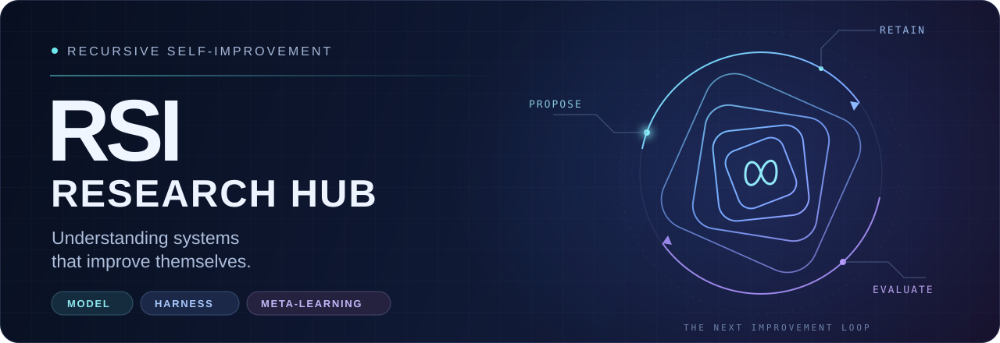
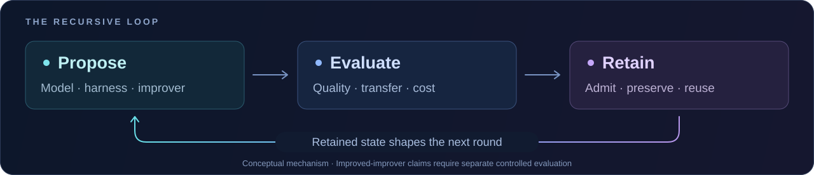

<h1 align="center">
  
</h1>

<p align="center">
  <strong>Primary-source reviews. Testable hypotheses. Reproducible protocols.</strong><br>
  Recursive self-improvement · Agent harness evolution · Model–harness co-evolution
</p>

<p align="center">
  <a href="papers/paper-index.md"><strong>Paper library</strong></a> &nbsp; · &nbsp;
  <a href="docs/research-trends.md"><strong>Research trends</strong></a> &nbsp; · &nbsp;
  <a href="experiments/benchmarks.md"><strong>Benchmarks</strong></a> &nbsp; · &nbsp;
  <a href="ROADMAP.md"><strong>Roadmap</strong></a>
</p>

| Reviewed papers | Research areas | Algorithm proposals | Benchmark guides |
| :---: | :---: | :---: | :---: |
| **[36](papers/paper-index.md)** | **[5](#research-map)** | **[4](#from-evidence-to-experiments)** | **[6](experiments/benchmarks.md)** |

This hub connects the RSI literature to critical synthesis, algorithm design, and controlled evaluation. We ask **what improves, why it improves, what the evidence supports, and which experiments could establish a new contribution**.

> **Research snapshot · November 19, 2026**
>
> Literature and protocol development. Scientific results remain author-reported; **no independent reproductions have been run**. The four algorithm proposals are unvalidated hypotheses. See the [source audit](docs/source-audit.md) for scope and limitations.

## Start exploring

<table>
  <tr>
    <td width="50%" valign="top">
      <h3>01 / Understand the field</h3>
      <p>Separate self-improvement, recursion, and evidence for a better improver.</p>
      <a href="docs/rsi-fundamentals.md">Foundations →</a> &nbsp; <a href="docs/research-trends.md">Trends →</a>
    </td>
    <td width="50%" valign="top">
      <h3>02 / Read the literature</h3>
      <p>Explore 36 structured reviews with source locators, limitations, and reproduction status.</p>
      <a href="papers/paper-index.md">Paper index →</a> &nbsp; <a href="papers/README.md">Reading routes →</a>
    </td>
  </tr>
  <tr>
    <td width="50%" valign="top">
      <h3>03 / Develop a hypothesis</h3>
      <p>Connect unresolved questions to baselines, falsifiable predictions, and novelty checks.</p>
      <a href="research/research-gaps.md">Research gaps →</a> &nbsp; <a href="research/model-harness-compatibility.md">Co-evolution proposal →</a>
    </td>
    <td width="50%" valign="top">
      <h3>04 / Design an experiment</h3>
      <p>Define held-out tasks, matched budgets, whole-loop costs, and independent audits.</p>
      <a href="experiments/evaluation-protocol.md">Evaluation protocol →</a> &nbsp; <a href="experiments/experiment-ideas.md">Study designs →</a>
    </td>
  </tr>
</table>

## Research map



The diagram is a conceptual loop. Its presence does not establish that a system improves its own improvement capability; that requires a separate, controlled comparison.

| Track | What changes | The question to answer |
| --- | --- | --- |
| **[Foundations](docs/rsi-fundamentals.md)** | Definitions and evidence | What distinguishes adaptation, recursion, and a better improver? |
| **[Harness RSI](docs/harness-rsi.md)** | Prompts, skills, tools, memory, workflows | Does a persistent update benefit the executor and transfer? |
| **[Model RSI](docs/model-rsi.md)** | Weights, synthetic data, RL, post-training | Does capability improve under a fixed or changing interface? |
| **[Meta-RSI](docs/meta-rsi.md)** | Improvement policies, meta-skills, search | Can a better improver transfer from a clean starting state? |
| **[Co-evolution](docs/model-harness-coevolution.md)** | Model–harness pairs | Can coupled updates improve utility without harmful regression? |

<details>
<summary><strong>The recursive loop, formally</strong></summary>

An agent may improve by changing model weights, prompts, tools, memory, skills, or control flow. Recursive self-improvement additionally involves retained changes participating in the production of further improvements. This mechanism should be distinguished from the stronger empirical claim that a later improver is actually better at improving a common starting agent.

Let $s_t=(\theta_t,h_t,m_t)$ be the model, harness, and memory, and $I_{\phi_t}$ an improvement procedure. A simplified loop is

**Propose a candidate:** $\widetilde{s}_{t+1}=I_{\phi_t}(s_t,E_t;B_t)$.

**Admit or reject it:** $s_{t+1}=\operatorname{Gate}(s_t,\widetilde{s}_{t+1};V_t)$.

Changing $\phi_t$ or reusing modified agent code can create recursion. Demonstrating a better improver requires a same-start, same-budget comparison and a separate audit. Merely increasing a benchmark score, writing more skills, or repeating a fixed training rule is insufficient. See [Foundations](docs/rsi-fundamentals.md).

Agent performance depends on the surrounding software as well as model parameters. Automating its improvement could reduce engineering effort, adapt smaller models to specialized workflows, and reuse knowledge across tasks. Feedback loops can also amplify benchmark shortcuts, noisy selection, incompatible updates, and hidden evaluation costs. Useful research must separate these effects before asserting progress.

</details>

## Recently reviewed

Recent papers in the reviewed collection, ordered by **first public date**. This is a curated snapshot; dates below are publication dates, not review dates.

| Published | Paper | What to examine |
| --- | --- | --- |
| Nov 18, 2026 | **[AHE-Beta](papers/2026/ahe-beta.md)** | Requirement-centered harness evolution; frozen transfer baselines and incomplete cost accounting |
| Nov 17, 2026 | **[The Resolution Hypothesis](papers/2026/resolution-hypothesis.md)** | Identifying useful agent changes; terminal candidate-pool evidence and unverified code release |
| Nov 16, 2026 | **[Evaluation-Free RSI](papers/2026/evaluation-free-rsi-elite.md)** | Search without task evaluation inside the loop; outcome evaluation remains necessary |
| Nov 13, 2026 | **[Self-Improvement Memory](papers/2026/sim.md)** | Structured optimizer memory; distinguish improver state from solver context |

**[Browse all 36 reviews →](papers/paper-index.md)** &nbsp; · &nbsp; [Machine-readable catalog](data/papers.json) &nbsp; · &nbsp; [BibTeX](references.bib)

<details>
<summary><strong>Eight anchor papers for a deeper reading path</strong></summary>

| Work | Reason to read | Evidence qualification |
| --- | --- | --- |
| [Darwin Gödel Machine](papers/2025/dgm.md) | Archive-based evolution of self-modifying agents | Bounded coding evaluations; empirical selection is not formal proof |
| [Hyperagents](papers/2026/hyperagents.md) | Editable task and meta-agent programs | Transfer results require attention to significance and retained state |
| [Meta-Harness](papers/2026/meta-harness.md) | Code-space search with rich experiment history | Coding search/test overlap differs from classification holdouts |
| [Harness²](papers/2026/harness2.md) | Behavioral contrasts and reusable harnessing experience | Feedback access and total probing cost matter |
| [Updating versus Benefit](papers/2026/harness-updating-not-benefit.md) | Distinguishes updater and executor capabilities | Skill use is not itself a causal effect |
| [HMED](papers/2026/hmed.md) | Learning from revision consequences | Same-state replay is already prior art |
| [JoMoHa](papers/2026/jomoha.md) | Joint model–harness RL | Compare fixed components, budgets, and seed coverage |
| [The RSI Tax](papers/2026/rsi-tax.md) | Whole-loop resource accounting | Charge unsuccessful verification and writing costs |

For earlier foundations, read [Gödel Machines](papers/foundations/godel-machines.md), [STaR](papers/foundations/star.md), [STOP](papers/foundations/stop.md), [DeepSeekMath/GRPO](papers/foundations/deepseekmath-grpo.md), and [GEPA](papers/2025/gepa.md). The [review guide](papers/README.md) provides routes by topic.

</details>

## From evidence to experiments

The reviewed work supports useful **bounded** harness and model adaptation. Development gains, held-out gains, and improved-improver evidence can diverge. Generalization, stable co-evolution, reliable update admission, and whole-loop cost remain central problems. The [trend report](docs/research-trends.md) separates findings, open questions, and hypotheses.

| Research proposal | Core question | Read the design |
| --- | --- | --- |
| **Compatibility-aware co-evolution** | Can harmful model–harness interactions be predicted and controlled? | [Formulation and baselines →](research/model-harness-compatibility.md) |
| **Generalizable Meta-RSI** | Do improvement policies transfer across tasks, executors, and budgets? | [Transfer protocol →](research/generalizable-meta-rsi.md) |
| **Utility-aware harness adaptation** | Which specific updates produce a measurable causal benefit? | [Randomized evidence →](research/harness-benefit.md) |
| **Budget-efficient RSI** | Which evaluations are worth their cost for final selection? | [Cost-aware design →](research/efficient-rsi.md) |

These are **research hypotheses**, not original results. HMED, SIM, TRUST, and recent co-evolution methods cover important nearby ideas; each proposal specifies the comparisons needed before a novelty claim.

**Evaluation environments:** [SkillsBench · ALFWorld · WebShop · Terminal-Bench · SWE-bench · ToolSandbox](experiments/benchmarks.md). The benchmark catalog separates current releases from historical paper configurations.

**Next milestone:** a pinned, costed direct comparison of update utility with sealed task-family evaluation. Follow the [roadmap](ROADMAP.md) for exit criteria.

## Research toolkit

| Find | Resources |
| --- | --- |
| Implementations and data | [Frameworks](resources/frameworks.md) · [Datasets](resources/datasets.md) · [Open-source projects](resources/open-source-projects.md) |
| Review and experiment formats | [Paper review template](templates/paper-review.md) · [Experiment report template](templates/experiment-report.md) |
| Provenance and citations | [Source audit](docs/source-audit.md) · [Paper metadata](data/papers.json) · [Bibliography](references.bib) · [CITATION.cff](CITATION.cff) |
| Maintenance | [Contribution guidelines](CONTRIBUTING.md) · [Validation record](data/repository-validation.json) · [Roadmap](ROADMAP.md) |

## Contribute

Add primary evidence, correct a source interpretation, or sharpen a testable claim. Use professional academic English, identify exact source versions, and distinguish reported findings, independent reproduction, and proposals. Start with the **[contribution guidelines](CONTRIBUTING.md)**.

<details>
<summary><strong>Run documentation checks</strong></summary>

Requires Node.js 22 or later:

```bash
npm ci --ignore-scripts
npm run lint
git diff --check
```

These commands check documentation, not scientific correctness. Citation review, local-link checks, data provenance, and sensitive-file inspection are additional requirements. The pinned GitHub Actions workflow runs on pushes and pull requests. See the [validation record](data/repository-validation.json) for observed local and hosted check results.

</details>

---

<p align="center">
  <strong>Understand the mechanism. Audit the evidence. Test the next idea.</strong><br>
  <sub>Cite original papers for their methods and results; cite this hub for its synthesis and proposed protocols.</sub>
</p>
